<!-- Auto-generated by Eshtiaq Developer Universe. Do not edit manually. -->

  

  <b>External Monitor Credits Feed:</b> 81 unique commits across 11 accessible public branches in 8 repositories

  

  <a href="https://github.com/Eshtiaq-a?tab=repositories" target="_blank" rel="noopener noreferrer" title="Browse Eshtiaq-a public repositories on GitHub"></a>

  <a href="https://github.com/Eshtiaq-a/Wrechship" target="_blank" rel="noopener noreferrer" title="Wrechship — WrechShip is a shipwreck and maritime-disaster dataset till 2026, with vessel names, loss dates, available times, vessel types, incident details, and wreck coordinates.">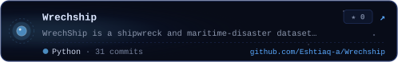</a> <a href="https://github.com/Eshtiaq-a/stash-money-manager" target="_blank" rel="noopener noreferrer" title="stash-money-manager — this is a money management app for university going students who tends to save money regularly , making it a bit fun to save money .">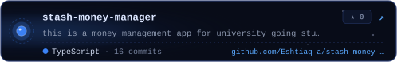</a> 
  <a href="https://github.com/Eshtiaq-a/Clear-Cut-" target="_blank" rel="noopener noreferrer" title="Clear-Cut- — a platform where you can see discounted products from many companies around the globe">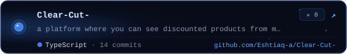</a> <a href="https://github.com/Eshtiaq-a/Eshtiaq-a" target="_blank" rel="noopener noreferrer" title="Eshtiaq-a — No description provided yet.">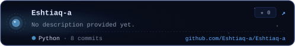</a> 
  <a href="https://github.com/Eshtiaq-a/C-code-Practices-" target="_blank" rel="noopener noreferrer" title="C-code-Practices- — here i will store all the problems i solved in C . as C is one of the mother language , i am trying to master it .">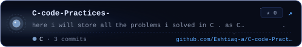</a> <a href="https://github.com/Eshtiaq-a/assignment_1" target="_blank" rel="noopener noreferrer" title="assignment_1 — No description provided yet.">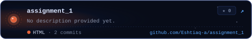</a> 
  <a href="https://github.com/Eshtiaq-a/Portfolio-main" target="_blank" rel="noopener noreferrer" title="Portfolio-main — this is my portfolio site where ill be sharing my works">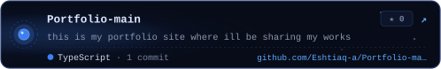</a> <a href="https://github.com/Eshtiaq-a/test" target="_blank" rel="noopener noreferrer" title="test — No description provided yet.">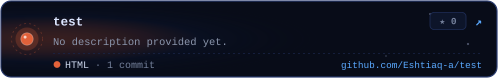</a>

  <b>Repo Galaxy:</b> <a href="https://github.com/Eshtiaq-a/Eshtiaq-a" target="_blank" rel="noopener noreferrer" title="No description provided."><code>Eshtiaq-a/</code></a> · <a href="https://github.com/Eshtiaq-a/Clear-Cut-" target="_blank" rel="noopener noreferrer" title="a platform where you can see discounted products from many companies around the globe"><code>Clear-Cut-/</code></a> · <a href="https://github.com/Eshtiaq-a/Portfolio-main" target="_blank" rel="noopener noreferrer" title="this is my portfolio site where ill be sharing my works"><code>Portfolio-main/</code></a> · <a href="https://github.com/Eshtiaq-a/Wrechship" target="_blank" rel="noopener noreferrer" title="WrechShip is a shipwreck and maritime-disaster dataset till 2026, with vessel names, loss dates, available times, vessel types, incident details, and wreck coordinates."><code>Wrechship/</code></a> · <a href="https://github.com/Eshtiaq-a/C-code-Practices-" target="_blank" rel="noopener noreferrer" title="here i will store all the problems i solved in C . as C is one of the mother language , i am trying to master it ."><code>C-code-Practices-/</code></a> · <a href="https://github.com/Eshtiaq-a/stash-money-manager" target="_blank" rel="noopener noreferrer" title="this is a money management app for university going students who tends to save money regularly , making it a bit fun to save money ."><code>stash-money-manager/</code></a> · <a href="https://github.com/Eshtiaq-a/assignment_1" target="_blank" rel="noopener noreferrer" title="No description provided."><code>assignment_1/</code></a> · <a href="https://github.com/Eshtiaq-a/test" target="_blank" rel="noopener noreferrer" title="No description provided."><code>test/</code></a>

  

  <a href="https://github.com/Eshtiaq-a" target="_blank" rel="noopener noreferrer" title="View Eshtiaq-a GitHub contribution activity"></a>

  <b>3D Contribution City:</b> 89 contributions across 17 active days · Peak: 2026-07-26 (23)

  

  <a href="https://github.com/Eshtiaq-a?tab=repositories" target="_blank" rel="noopener noreferrer">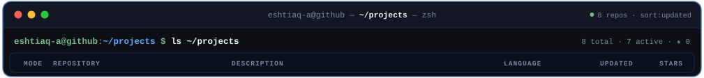</a><a href="https://github.com/Eshtiaq-a/Eshtiaq-a" target="_blank" rel="noopener noreferrer" title="Eshtiaq-a — No description provided.">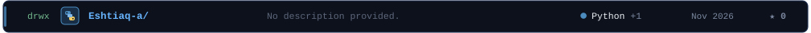</a><a href="https://github.com/Eshtiaq-a/Portfolio-main" target="_blank" rel="noopener noreferrer" title="Portfolio-main — this is my portfolio site where ill be sharing my works">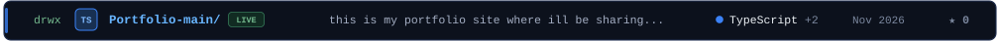</a><a href="https://github.com/Eshtiaq-a/Wrechship" target="_blank" rel="noopener noreferrer" title="Wrechship — WrechShip is a shipwreck and maritime-disaster dataset till 2026, with vessel names, loss dates, available times, vessel types, incident details, and wreck coordinates.">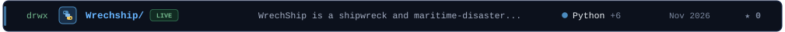</a><a href="https://github.com/Eshtiaq-a/C-code-Practices-" target="_blank" rel="noopener noreferrer" title="C-code-Practices- — here i will store all the problems i solved in C . as C is one of the mother language , i am trying to master it .">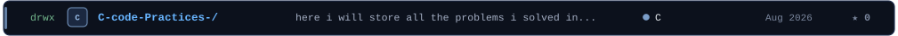</a><a href="https://github.com/Eshtiaq-a/stash-money-manager" target="_blank" rel="noopener noreferrer" title="stash-money-manager — this is a money management app for university going students who tends to save money regularly , making it a bit fun to save money .">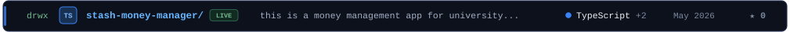</a><a href="https://github.com/Eshtiaq-a/assignment_1" target="_blank" rel="noopener noreferrer" title="assignment_1 — No description provided.">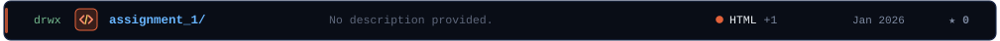</a><a href="https://github.com/Eshtiaq-a/test" target="_blank" rel="noopener noreferrer" title="test — No description provided.">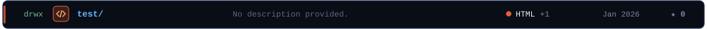</a>

  <b>~/projects:</b> <a href="https://github.com/Eshtiaq-a/Eshtiaq-a" target="_blank" rel="noopener noreferrer" title="No description provided."><code>Eshtiaq-a/</code></a> · <a href="https://github.com/Eshtiaq-a/Clear-Cut-" target="_blank" rel="noopener noreferrer" title="a platform where you can see discounted products from many companies around the globe"><code>Clear-Cut-/</code></a> · <a href="https://github.com/Eshtiaq-a/Portfolio-main" target="_blank" rel="noopener noreferrer" title="this is my portfolio site where ill be sharing my works"><code>Portfolio-main/</code></a> · <a href="https://github.com/Eshtiaq-a/Wrechship" target="_blank" rel="noopener noreferrer" title="WrechShip is a shipwreck and maritime-disaster dataset till 2026, with vessel names, loss dates, available times, vessel types, incident details, and wreck coordinates."><code>Wrechship/</code></a> · <a href="https://github.com/Eshtiaq-a/C-code-Practices-" target="_blank" rel="noopener noreferrer" title="here i will store all the problems i solved in C . as C is one of the mother language , i am trying to master it ."><code>C-code-Practices-/</code></a> · <a href="https://github.com/Eshtiaq-a/stash-money-manager" target="_blank" rel="noopener noreferrer" title="this is a money management app for university going students who tends to save money regularly , making it a bit fun to save money ."><code>stash-money-manager/</code></a> · <a href="https://github.com/Eshtiaq-a/assignment_1" target="_blank" rel="noopener noreferrer" title="No description provided."><code>assignment_1/</code></a> · <a href="https://github.com/Eshtiaq-a/test" target="_blank" rel="noopener noreferrer" title="No description provided."><code>test/</code></a>

Accessible Directory Index &amp; Full Descriptions (8 public repositories)

| Repository | Description | Languages | Stars | Updated | Live |
|---|---|---|---:|---|---|
| <a href="https://github.com/Eshtiaq-a/Eshtiaq-a" target="_blank" rel="noopener noreferrer"><code>Eshtiaq-a/</code></a> | No description provided. | Python, CSS | ★ 0 | Nov 2026 | — |
| <a href="https://github.com/Eshtiaq-a/Clear-Cut-" target="_blank" rel="noopener noreferrer"><code>Clear-Cut-/</code></a> | a platform where you can see discounted products from many companies around the globe | TypeScript, PLpgSQL, JavaScript | ★ 0 | Nov 2026 | [Live](https://clear-cut-seven.vercel.app) |
| <a href="https://github.com/Eshtiaq-a/Portfolio-main" target="_blank" rel="noopener noreferrer"><code>Portfolio-main/</code></a> | this is my portfolio site where ill be sharing my works | TypeScript, HTML, JavaScript | ★ 0 | Nov 2026 | [Live](https://portfolio-main-gilt-nu.vercel.app) |
| <a href="https://github.com/Eshtiaq-a/Wrechship" target="_blank" rel="noopener noreferrer"><code>Wrechship/</code></a> | WrechShip is a shipwreck and maritime-disaster dataset till 2026, with vessel names, loss dates, available times, vessel types, incident details, and wreck coordinates. | Python, HTML, JavaScript, CSS, PowerShell, Shell, Go Template | ★ 0 | Nov 2026 | [Live](https://www.wreckship.me/) |
| <a href="https://github.com/Eshtiaq-a/C-code-Practices-" target="_blank" rel="noopener noreferrer"><code>C-code-Practices-/</code></a> | here i will store all the problems i solved in C . as C is one of the mother language , i am trying to master it . | C | ★ 0 | Aug 2026 | — |
| <a href="https://github.com/Eshtiaq-a/stash-money-manager" target="_blank" rel="noopener noreferrer"><code>stash-money-manager/</code></a> | this is a money management app for university going students who tends to save money regularly , making it a bit fun to save money . | TypeScript, CSS, JavaScript | ★ 0 | May 2026 | [Live](https://stash-saver.vercel.app/) |
| <a href="https://github.com/Eshtiaq-a/assignment_1" target="_blank" rel="noopener noreferrer"><code>assignment_1/</code></a> | No description provided. | HTML, CSS | ★ 0 | Jan 2026 | — |
| <a href="https://github.com/Eshtiaq-a/test" target="_blank" rel="noopener noreferrer"><code>test/</code></a> | No description provided. | HTML, CSS | ★ 0 | Jan 2026 | — |

