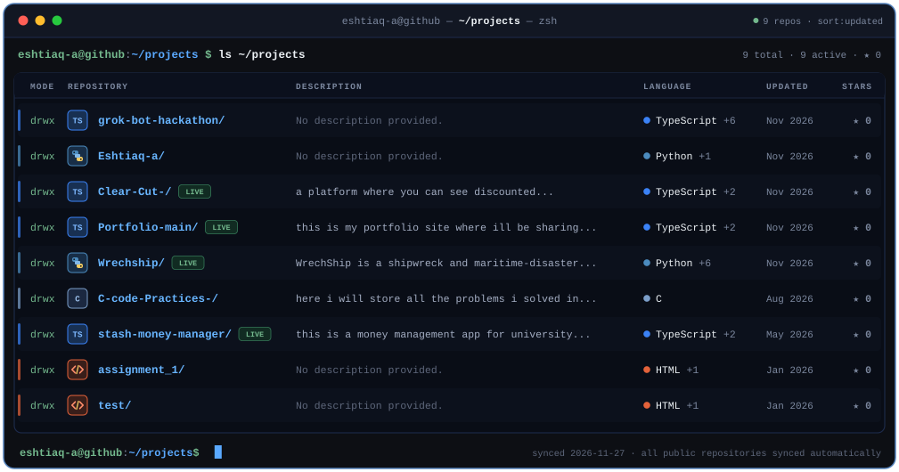

<!-- Auto-generated by Eshtiaq Developer Universe. Do not edit manually. -->

  

  <b>External Monitor Credits Feed:</b> 68 unique commits across 10 accessible public branches in 7 repositories

  

  

  

  

  <b>~/projects:</b> <a href="https://github.com/Eshtiaq-a/Eshtiaq-a" title="No description provided."><code>Eshtiaq-a/</code></a> · <a href="https://github.com/Eshtiaq-a/Clear-Cut-" title="a platform where you can see discounted products from many companies around the globe"><code>Clear-Cut-/</code></a> · <a href="https://github.com/Eshtiaq-a/Portfolio-main" title="this is my portfolio site where ill be sharing my works"><code>Portfolio-main/</code></a> · <a href="https://github.com/Eshtiaq-a/Wrechship" title="WrechShip is a shipwreck and maritime-disaster dataset till 2026, with vessel names, loss dates, available times, vessel types, incident details, and wreck coordinates."><code>Wrechship/</code></a> · <a href="https://github.com/Eshtiaq-a/C-code-Practices-" title="here i will store all the problems i solved in C . as C is one of the mother language , i am trying to master it ."><code>C-code-Practices-/</code></a> · <a href="https://github.com/Eshtiaq-a/stash-money-manager" title="this is a money management app for university going students who tends to save money regularly , making it a bit fun to save money ."><code>stash-money-manager/</code></a> · <a href="https://github.com/Eshtiaq-a/assignment_1" title="No description provided."><code>assignment_1/</code></a> · <a href="https://github.com/Eshtiaq-a/test" title="No description provided."><code>test/</code></a>

Accessible Directory Index &amp; Full Descriptions (8 public repositories)

| Repository | Description | Languages | Stars | Updated | Live |
|---|---|---|---:|---|---|
| [`Eshtiaq-a/`](https://github.com/Eshtiaq-a/Eshtiaq-a) | No description provided. | Python | ★ 0 | Nov 2026 | — |
| [`Clear-Cut-/`](https://github.com/Eshtiaq-a/Clear-Cut-) | a platform where you can see discounted products from many companies around the globe | TypeScript, PLpgSQL, JavaScript | ★ 0 | Nov 2026 | [Live](https://clear-cut-seven.vercel.app) |
| [`Portfolio-main/`](https://github.com/Eshtiaq-a/Portfolio-main) | this is my portfolio site where ill be sharing my works | TypeScript, HTML, JavaScript | ★ 0 | Nov 2026 | [Live](https://portfolio-main-gilt-nu.vercel.app) |
| [`Wrechship/`](https://github.com/Eshtiaq-a/Wrechship) | WrechShip is a shipwreck and maritime-disaster dataset till 2026, with vessel names, loss dates, available times, vessel types, incident details, and wreck coordinates. | Python, HTML, JavaScript, CSS, PowerShell, Shell, Go Template | ★ 0 | Nov 2026 | [Live](https://www.wreckship.me/) |
| [`C-code-Practices-/`](https://github.com/Eshtiaq-a/C-code-Practices-) | here i will store all the problems i solved in C . as C is one of the mother language , i am trying to master it . | C | ★ 0 | Aug 2026 | — |
| [`stash-money-manager/`](https://github.com/Eshtiaq-a/stash-money-manager) | this is a money management app for university going students who tends to save money regularly , making it a bit fun to save money . | TypeScript, CSS, JavaScript | ★ 0 | May 2026 | [Live](https://stash-saver.vercel.app/) |
| [`assignment_1/`](https://github.com/Eshtiaq-a/assignment_1) | No description provided. | HTML, CSS | ★ 0 | Jan 2026 | — |
| [`test/`](https://github.com/Eshtiaq-a/test) | No description provided. | HTML, CSS | ★ 0 | Jan 2026 | — |

